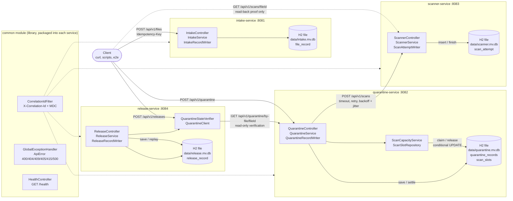
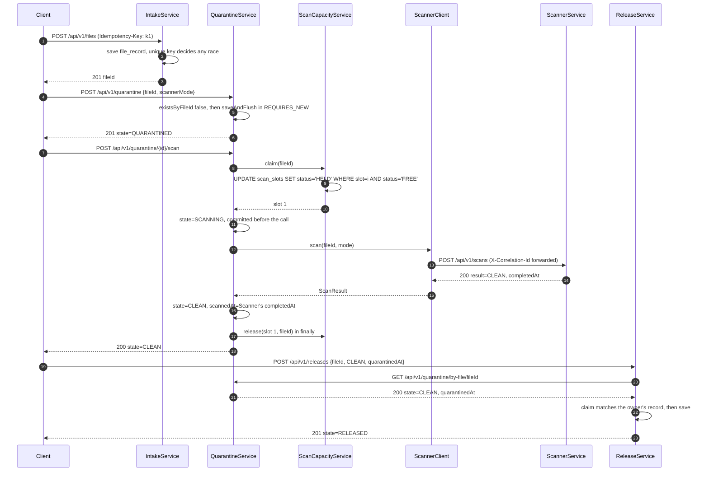
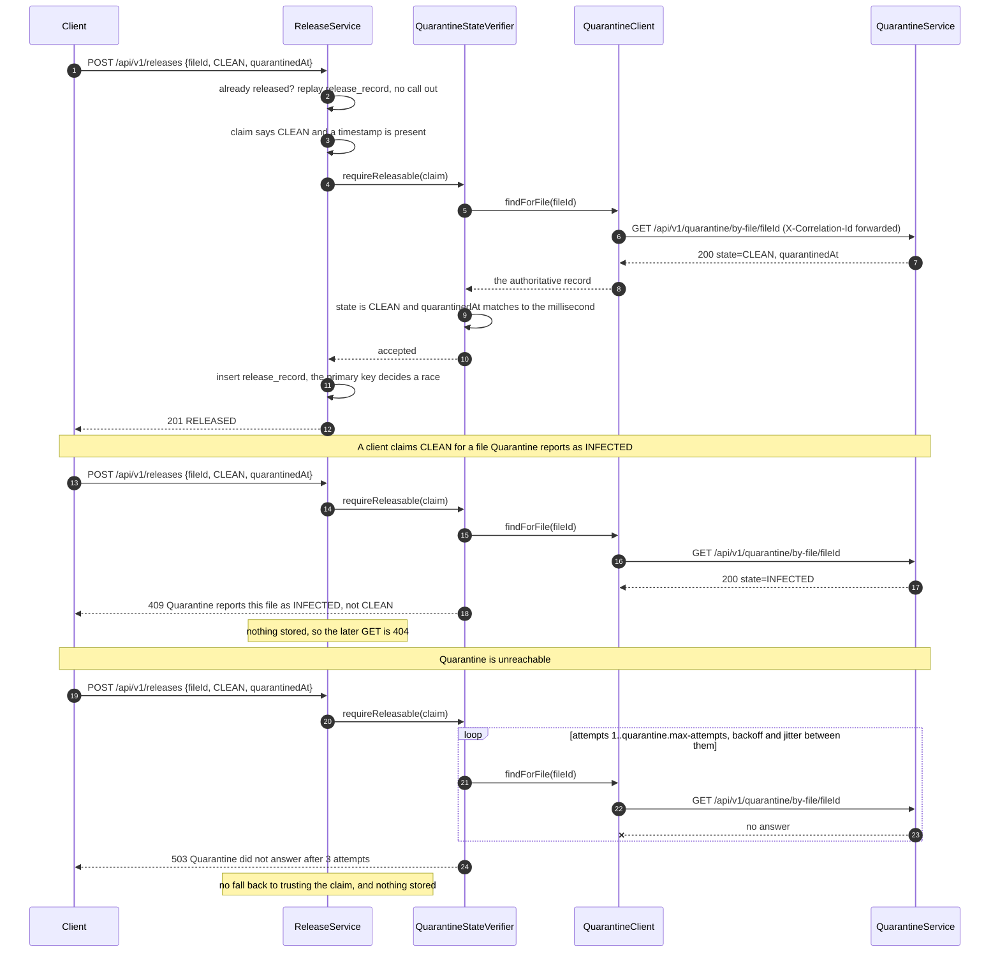
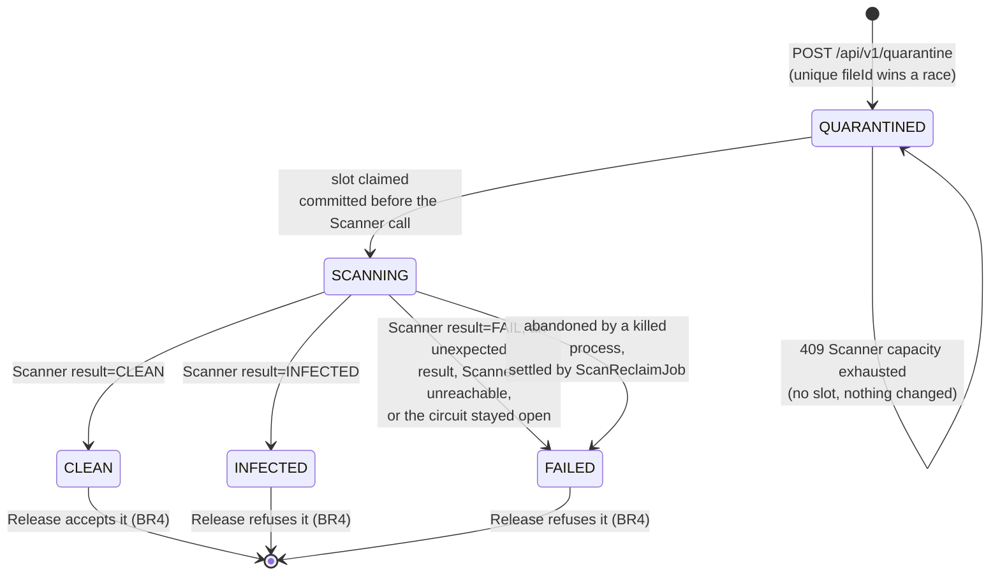
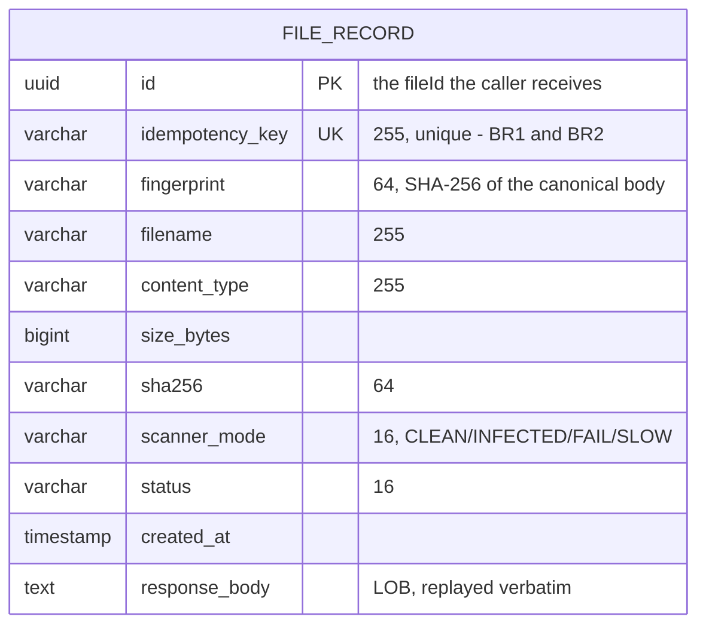
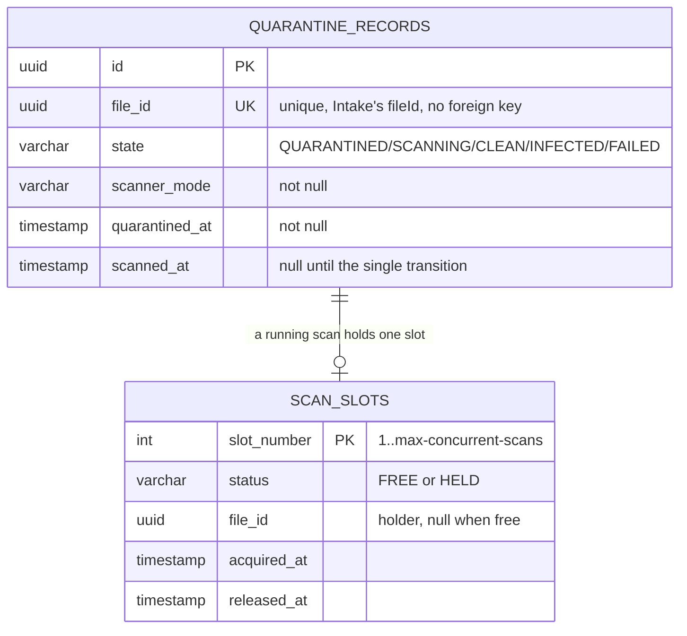
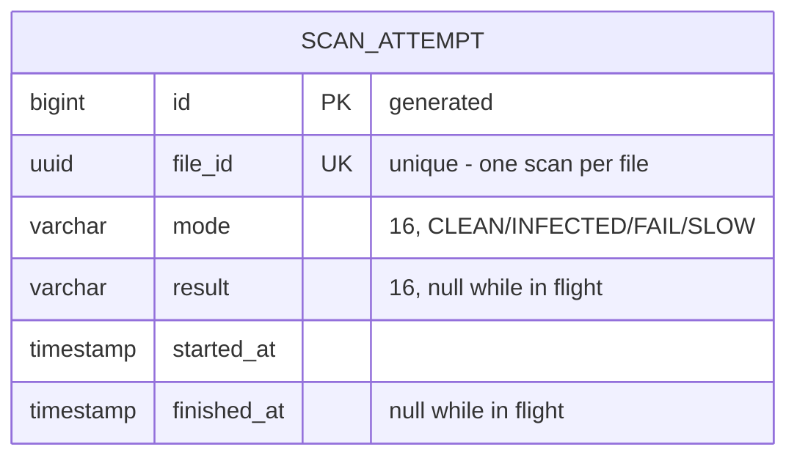
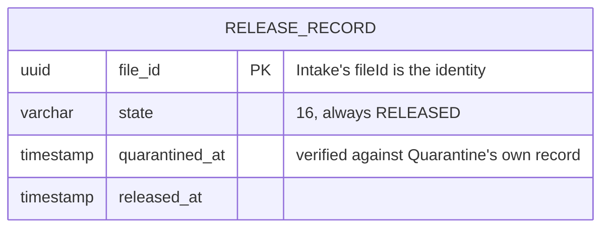

# Architecture

The diagrams here are drawn from the code in this repository, not from a design
intention. Every node name is a class, table, endpoint or configuration value that
exists in the source, and each diagram says which test or script proves it. Mermaid
renders on GitHub, in the IDE preview and in the report PDF export.

## Component and deployment view

Four independent Spring Boot entry points, one HTTP port and one file-based H2
database each. `common` is a compile-time library, not a running service. Two edges go
between services: Quarantine asks Scanner for a verdict, and Release asks Quarantine to
confirm one. Neither of them reads another service's database.

Reading the edges:

* The `Quarantine -> Scanner` edge is the assignment's service-to-service REST call.
  It is the caller of Challenge 3A: `scanner.connect-timeout-millis`,
  `scanner.read-timeout-millis`, `scanner.max-attempts`,
  `scanner.retry-base-millis`, `scanner.retry-jitter-millis`, plus the optional
  circuit breaker (`scanner.circuit-breaker.*`, off by default).
* The `Release -> Quarantine` edge is a read-only verification with its own
  `quarantine.*` budget: Release will not grant a release on a state it can only be
  told about. It stores nothing new from that read beyond the decision it makes, so
  data ownership is unchanged.
* The `Client -.-> Scanner` dashed edge is not part of the transaction. `scripts/e2e.sh`
  reads `GET /api/v1/scans/{fileId}` afterwards to prove the call really reached
  Scanner's own database.
* Release is still called by the client, and the client still submits the quarantine
  evidence. What changed is that the submission is now a claim that gets checked against
  the owning service rather than the whole basis of the decision. No service opens
  another service's database, so there is no shared-schema edge anywhere in this diagram.
* Both chains are two hops deep - client to Quarantine to Scanner, client to Release to
  Quarantine - which stays inside the design rule about not drawing a request through a
  long synchronous chain.
* `data/quarantine.mv.db` holds two tables because Quarantine owns two contended
  resources: the record (unique `fileId`) and the scanner capacity slot table.

Proven by `scripts/e2e.sh` (32 asserted steps), `scripts/verification.py` and
`bash scripts/health.sh`.

## Happy-path sequence

One file, one quarantine record, one scan, one release. The scan transition claims a
capacity slot before the call and releases it in a `finally` block, so a failure still
returns the slot.

Proven by `QuarantineHttpTest`, `scripts/e2e.sh` (which asserts Quarantine's `scannedAt`
equals Scanner's stored `finishedAt`, and reads the same record Release verifies) and
`evidence/tests/e2e-run.txt`.

## Verification of a release

Release's own decision path, including the two ways it must not be granted. A replay of a
finished release never calls out, so a Quarantine outage cannot unmake a file that is
already out.

Proven by `QuarantineStateVerifierTest` for the verdict in isolation, `ReleaseServiceTest`
for when it is asked, `ReleaseHttpTest` against a stub Quarantine answering on the
application's own socket, and `evidence/tests/verification-run.txt`.

## Failure and contention sequence

Five ways a scan does not complete cleanly, all of which the client is told about
in the caller's own language rather than as a 500.

```mermaid
sequenceDiagram
    autonumber
    participant C as Client
    participant Q as QuarantineService
    participant SC as ScanCapacityService
    participant CL as ScannerClient
    participant A as ScannerService

    rect rgb(60, 60, 30)
        Note over C,A: Timeout, then a retry that succeeds (Challenge 3A)
        C->>Q: POST /api/v1/quarantine/{id}/scan
        Q->>SC: claim(fileId) -> slot 1
        Q->>CL: scan(fileId, SLOW)
        CL->>A: attempt 1 POST /api/v1/scans
        A--xCL: no response within read-timeout-millis
        CL->>CL: log scanner_attempt_failed (TimeoutException)
        CL->>CL: sleep base * 2^(attempt-1) + jitter
        CL->>A: attempt 2 POST /api/v1/scans
        A-->>CL: 200 result=CLEAN (same fileId, one stored attempt)
        CL-->>Q: ScanResult
        Q->>SC: release(slot 1) in finally
        Q-->>C: 200 state=CLEAN
        Note over A: scan_attempt still holds exactly one row for the fileId
    end

    rect rgb(30, 60, 40)
        Note over C,A: Scanner unreachable for the whole budget
        C->>Q: POST /api/v1/quarantine/{id}/scan
        Q->>SC: claim(fileId) -> slot 1
        Q->>CL: scan(fileId, CLEAN)
        loop attempts 1..max-attempts, backoff between them
            CL->>A: POST /api/v1/scans
            A--xCL: ConnectException / ClosedChannelException
        end
        CL-->>Q: ScannerUnavailableException
        Q->>Q: state=FAILED, settled once
        Q->>SC: release(slot 1) in finally
        Q-->>C: 200 state=FAILED (record is not left in SCANNING)
    end

    rect rgb(60, 30, 30)
        Note over C,SC: Capacity exhausted (Challenge 1)
        C->>Q: POST /api/v1/quarantine/{id}/scan (20th parallel request)
        Q->>SC: claim(fileId)
        SC->>SC: every slot UPDATE matched 0 rows
        SC-->>Q: -1
        Q-->>C: 409 Scanner capacity exhausted
        Note over Q: the record stays QUARANTINED, so the scan can be retried later
    end

    rect rgb(40, 40, 70)
        Note over C,Q: Concurrent create for the same fileId
        C->>Q: POST /api/v1/quarantine {fileId} (8 at once)
        Q->>Q: one saveAndFlush passes the unique fileId index
        Q->>Q: seven raise DataIntegrityViolationException
        Q-->>C: 1 x 201 and 7 x 409 File is already quarantined
    end

    rect rgb(25, 55, 60)
        Note over C,A: Circuit breaker open, with the bonus switch on
        C->>Q: POST /api/v1/quarantine/{id}/scan
        Q->>SC: claim(fileId) -> slot 1
        Q->>CL: scan(fileId, CLEAN)
        CL->>CL: breaker.allowCall() is false, state=OPEN
        CL-->>Q: ScannerUnavailableException, zero HTTP calls
        Q->>Q: state=FAILED, settled once
        Q->>SC: release(slot 1) in finally
        Q-->>C: 200 state=FAILED in milliseconds instead of the full budget
        Note over CL: after cooldown one probe is let through — success closes it
    end

    rect rgb(55, 25, 55)
        Note over Q,A: The process is killed mid-scan
        Q->>SC: slot 1 HELD, record SCANNING
        Note over Q: SIGKILL - the finally block never runs, both rows stay as they are
        Q->>Q: restart, ScanReclaimJob runs
        Q->>SC: UPDATE scan_slots SET status='FREE' WHERE status='HELD' AND acquiredAt < cutoff
        Q->>Q: UPDATE quarantine_records SET state='FAILED' WHERE state='SCANNING' AND no slot held
        Note over Q: capacity is whole again and no record is stranded in SCANNING
    end
```

Proven by `QuarantineScanResilienceTest` and `QuarantineCircuitBreakerTest` (in-JVM, stub
Scanner on the same port), `ScanReclaimJobTest`,
`scripts/resilience.py` including its Part E (`evidence/challenge-3a-resilience/run.txt`),
`scripts/reclaim.py` (`evidence/challenge-1-concurrency/reclaim-run.txt`) and
`scripts/concurrency.py` (`evidence/challenge-1-concurrency/run.txt`).

## Quarantine state machine

`QUARANTINED` leaves once. `SCANNING` exists only while a capacity slot is held, so a
concurrent scan request can see it and is refused, and no record can end in
`SCANNING` when a request finishes - or after a crash, because the reclaim sweep settles
an abandoned scan as `FAILED`.

Settled states are final: a second scan of any record is 409 `File has already been
scanned`, including of a `FAILED` one, because a retry would be a second operation on
the same file.

Proven by `QuarantineServiceTest`, `QuarantineScanResilienceTest` and the state
counts in `GET /api/v1/quarantine/_evidence/summary`.

## Data ownership

Four separate H2 databases. The `fileId` value is the only identifier that crosses a
boundary, and it crosses as data in a request body, never as a join. Entity names below
are the JPA table names in capitals; each block is the columns of that table exactly as
the `@Column` declarations define them, with the constraint that arbitrates a race
marked `PK` or `UK`.

| Table | Owner | Contended resource | Rule |
|---|---|---|---|
| `file_record` | Intake | `uk_file_idempotency_key` | BR1, BR2 |

| Table | Owner | Contended resource | Rule |
|---|---|---|---|
| `quarantine_records` | Quarantine | unique `file_id` | BR3 |
| `scan_slots` | Quarantine | `status='FREE'` in the claim predicate | Challenge 1 |

The relationship above is the invariant that is not a key: a `HELD` slot row names a file
whose record is in `SCANNING`, and both are set back before the response is written.
`ScanSlotRepository.release` matches on `slotNumber`, `status='HELD'` *and* `fileId`, so a
late release cannot free a slot a different file has already retaken. When a process dies
before either statement runs, `ScanReclaimJob` restores the same invariant: slots held
past `QUARANTINE_SLOT_STALE_MILLIS` are freed and the records still in `SCANNING` for them
are settled `FAILED`, in that order, so a scan that is still running is never interrupted.

| Table | Owner | Contended resource | Rule |
|---|---|---|---|
| `scan_attempt` | Scanner | `uk_scan_attempt_file_id` | makes Quarantine's retries duplicate-free |

| Table | Owner | Contended resource | Rule |
|---|---|---|---|
| `release_record` | Release | primary key `file_id` | BR4 |

## Cross-service contract

| Caller | Callee | Endpoint | Body | Failure the caller must handle |
|---|---|---|---|---|
| Quarantine `ScannerClient` | Scanner | `POST /api/v1/scans` | `{fileId, mode}` | connect timeout, read timeout, 409 in-flight, no response at all, and its own open circuit |
| Release `QuarantineClient` | Quarantine | `GET /api/v1/quarantine/by-file/{fileId}` | none, the id is in the path | connect timeout, read timeout, 404 meaning never quarantined, 5xx retried then answered as 503 |

Contract: [`openapi/scanner.yaml`](openapi/scanner.yaml), consumed as
`ScanResult{fileId, result, message, completedAt}`. The retry budget is
`scanner.*` in
[`quarantine-service/src/main/resources/application.yml`](../quarantine-service/src/main/resources/application.yml);
`scanner-service`'s `SCANNER_SLOW_MILLIS` (default 2000 ms) is below the default read
timeout (5000 ms), so the shipped defaults never time out. The evidence scripts pass
both values on the command line to put a slow scan deliberately over the budget without
changing any code or packaged artifact.

Release's read is a separate edge with a separate budget (`quarantine.*` in
[`release-service/src/main/resources/application.yml`](../release-service/src/main/resources/application.yml)),
configured exactly like the Scanner one: timeouts, attempts, backoff base and jitter.
Neither client lives in a shared library: each service owns its outbound calls, so no
service's build depends on another's resilience code, which is why the delay formula is
duplicated in `ScannerClient` and `QuarantineClient` rather than factored into `common`.

`X-Correlation-Id` is forwarded from the original client request through
`MDC("correlationId")`, so one request is traceable across every service log; the
evidence files show the same correlation ID in the Quarantine and Scanner lines, and
`scripts/verification.py` puts one ID on a release, its verification read and Quarantine's
own answer.

## What is deliberately not here

* No message broker, no async worker and no database sharing. The scan is
  synchronous: the caller waits for Scanner's verdict, which is what makes the
  timeout and retry behaviour observable.
* A circuit breaker, but off by default. Challenge 3A names it as the bonus, and with it
  on, a scan can be refused without ever reaching Scanner - the right behaviour during an
  outage and the wrong one for demonstrating timeouts and backoff. It counts failed calls
  rather than failed attempts, so enabling it never changes what a single scan's retry
  budget looks like; `scanner.circuit-breaker.enabled` turns it on and
  `scripts/resilience.py` Part E shows both settings side by side.
* No orchestration of the release by Quarantine. The verdict owner does not decide when a
  file is let go: the client calls Release and Release verifies the state at Quarantine.
  Automatic release on a clean scan would put BR4 in the wrong service and make a release
  a side effect of a call whose whole point is that it may already have taken effect.
* No in-memory semaphore for capacity. The slot table is the contended resource so
  that the database, not one JVM, decides the winner and the allocation survives a
  restart — see `evidence/challenge-1-concurrency/README.md`.
* Retries sleep on the request thread. With Tomcat's default 200 worker threads this
  is acceptable for the demonstration load; a production caller would move the scan
  off the request thread.
