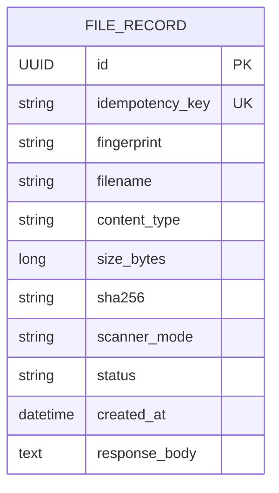

# Intake service

Intake accepts file metadata and assigns a file ID. It owns the metadata,
idempotency key, request fingerprint and original response. It does not store
file content, verify the supplied hash against content, scan files or authorize
release. `scannerMode` configures the mock Scanner used later in the workflow.

## Run

From the repository root:

```bash
mvn -pl intake-service -am clean package
java -jar intake-service/target/intake-service-1.0.0-SNAPSHOT.jar
```

Default port is 8081. Use the variables in `.env.example` for overrides.
On the machine with the separate Maven settings from setup, add
`-s ../maven-settings.xml` to the Maven command. This is a local setup detail;
other machines with access to Maven Central do not need this file.

Intake uses its own file-based H2 database and credentials. The defaults are
`DB_URL=jdbc:h2:file:./data/intake` and `DDL_AUTO=update`. Metadata, idempotency keys,
fingerprints and stored responses survive application restarts. No other service
reads this database. Schema migrations remain future work; `update` is used for
this local assignment setup.

Start Java from the repository root every time. The database is stored in
`data/intake.mv.db`, relative to the working directory. Starting from another
directory with the same relative URL creates/opens a different database. To use
the same database regardless of working directory, export an absolute URL:

```bash
export DB_URL="jdbc:h2:file:/absolute/path/to/intake-data/intake"
```

Use a location writable by the process, and keep the URL and credentials the same
across restarts. Leave off the `.mv.db` extension in the JDBC URL. `data/` and H2
database/trace/lock files are excluded from Git. The database file is local state,
not source code or submission evidence. Stop Intake before backing up its file.
Run one process per embedded database file; multiple replicas require a shared
database server rather than opening this file from separate Java processes.

## API

| Method | Endpoint | Result |
|---|---|---|
| GET | `/health` | 200 liveness |
| POST | `/api/v1/files` | 201 accepted or original response replayed |
| GET | `/api/v1/files/{id}` | 200 original accepted response; 404 unknown ID |
| GET | `/api/v1/files/_evidence/idempotency/{key}` | Read-only database row count |

```bash
curl -i http://localhost:8081/api/v1/files \
  -H 'Content-Type: application/json' \
  -H 'Idempotency-Key: demo-intake-1' \
  -H 'X-Correlation-Id: intake-demo-1' \
  -d '{"filename":"demo.txt","contentType":"text/plain","sizeBytes":4,"sha256":"aaaaaaaaaaaaaaaaaaaaaaaaaaaaaaaaaaaaaaaaaaaaaaaaaaaaaaaaaaaaaaaa","scannerMode":"CLEAN"}'
```

The response contains `fileId`, `status: RECEIVED`, `filename`, `scannerMode` and
`receivedAt`. The main workflow passes `fileId` to Quarantine. Intake runs without
the other business services, which are implemented separately.

Every metadata field is required. Filename/content type must be nonblank and at
most 255 characters; size must be a nonnegative integer; SHA-256 must have 64
hexadecimal characters; mode must be CLEAN, INFECTED, FAIL or SLOW. Keys are
case-sensitive, nonblank and at most 255 characters. Invalid input returns 400,
different payload for an existing key returns 409, and unsupported content type
returns 415. Errors use the shared format:

```json
{"timestamp":"...","status":409,"error":"Conflict","message":"Idempotency-Key was used with a different payload","path":"/api/v1/files","correlationId":"intake-demo-1","fieldErrors":{}}
```

`X-Correlation-Id` is echoed and included in request/replay logs. It is generated
when omitted. Headers describe the current request; the stored response body
describes the original operation. See [the OpenAPI contract](../docs/openapi/intake.yaml).

## How idempotency works

1. Validate the request and SHA-256 the JSON representation of its typed fields.
   JSON property order/whitespace do not affect identity; changed field values do.
   Using JSON avoids ambiguous fingerprints from delimiter-separated values.
2. For an existing key, compare fingerprints. A match replays the stored response
   including its original ID and timestamp. A mismatch returns a conflict.
3. For a new key, insert metadata, key, fingerprint and response in one transaction.
   The database's `uk_file_idempotency_key` constraint permits one row per key.
4. If concurrent requests both observe a missing key, one insert wins. The losing
   insert rolls back inside `IntakeRecordWriter` before Intake rereads the winner.
   It then replays or returns 409. Unrelated database failures are not replays.

A plain check followed by an insert races because both requests may see an absent
key. The database constraint makes the decision atomic. There is no per-key
in-memory lock map. Replicas would need to share the same service-owned database;
separate local database files do not provide cross-replica coordination.

During a simultaneous create test, Hibernate may log a unique-key violation for
a losing insert. Intake catches that race after rollback and returns the winner's
response. Check the HTTP results and database count: the expected result is all
201 responses and one row, rather than an unhandled 500.

Storing the response as JSON prevents database timestamp precision from changing
the replay. Successful POSTs return the original 201; GET returns 200. A different
key creates another intake operation even with identical content hashes.
Content deduplication and idempotency are different business rules.

## Assignment traceability

| Requirement | Code | Verification |
|---|---|---|
| BR1: same key/payload replay without another record | `IntakeService`, response snapshot, unique key | Unit replay test; HTTP replay and 8 simultaneous requests |
| BR2: different payload for same key is rejected | `IntakeService.replay` | Unit conflict/race tests; HTTP sequential/simultaneous conflicts |
| REST versioning, validation and consistent errors | `IntakeController`, `IntakeRequest`, shared error handler | HTTP invalid metadata/key/JSON/UUID and 400/404/405/409/415 tests |
| Database per service | `FileRecord`, `FileRepository`, Intake configuration | Tests inspect actual H2 row counts and stored response |
| Health and correlation | Shared health endpoint/filter | HTTP health, response header and error correlation tests |
| Challenge 2 | Key, fingerprint, stored response and database constraint | `scripts/idempotency.sh`, its output and replay logs |

Run unit and real HTTP/H2 tests:

```bash
mvn -pl intake-service -am test
```

Tests use a separate H2 database and a temporary port. Reports are written to
`intake-service/target/surefire-reports/`. With Intake running, run
`bash scripts/idempotency.sh`; see [evidence capture instructions](../evidence/challenge-2-idempotency/README.md).
Challenge 1 belongs to Quarantine's capacity control; Challenge 3A belongs to its
Scanner client. Intake does not own these responsibilities.

## Verify persistence across restarts

Build the JAR, then run from the repository root:

```bash
python3 scripts/persistence.py
```

The script starts Intake twice using the same temporary file-based H2 database
and a temporary local port. It creates metadata, stops the first process, starts
the second, reads the original file and retries the original key. It asserts the
same full response and one database row. It uses the application's default schema
setting, so changing it to `create-drop` makes this check fail.

The test uses its own database and never opens, deletes or resets `data/intake.mv.db`.
Its processes stop and temporary files are removed after the check. The existing
HTTP tests continue to use isolated in-memory H2 with `create-drop`.

For a manual check against your running service, create a record, retain its key
and response, stop/restart Intake from the same directory, then GET the file and
repeat the POST with that key/payload. Both must return the original response,
and the evidence endpoint must report one row.

## Data design



There are no cross-service foreign keys. Intake stays RECEIVED; the other
services own later states. Keys remain valid for the lifetime of this database;
key expiry, authentication and actual uploads are outside this implementation.
