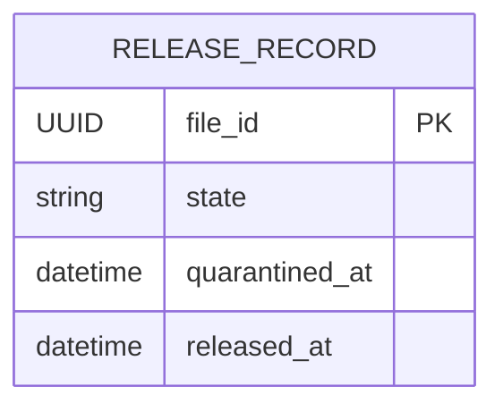

# Release Service

Owns the terminal release decision for a file that has finished quarantine. It
records `RELEASED` for a file only when **Quarantine's own record** reports the state
as `CLEAN` and the quarantine timestamp matches (business rule BR4). The caller's
`quarantineState` is a claim, not the authority. Release has its own H2 database, reads
another service only through its REST API, and never reads another service's tables.

| Item | Value |
|---|---|
| Port | 8084 (`SERVER_PORT`) |
| Base path | `/api/v1/releases` |
| Database | H2 file `data/release.mv.db` |
| Owner | Release |
| Dependency | Quarantine (`GET /api/v1/quarantine/by-file/{fileId}`, read-only verification) |

## Start it

```bash
mvn -pl release-service -am package
java -jar release-service/target/release-service-1.0.0-SNAPSHOT.jar
```

Run from the repository root so the relative database path stays stable. Export
`SERVER_PORT`, `DB_URL`, `DB_USERNAME`, `DB_PASSWORD`, `DB_DRIVER` and `DDL_AUTO`
in this service's terminal to override configuration; see `.env.example`. Spring
Boot does not load that file automatically.

Quarantine has to be running for a file to be released, because the state is verified
rather than accepted. Release itself starts fine without it and answers 503 until the
dependency answers; a file that is already released still replays while Quarantine is
down.

| Variable | Default | Meaning |
|---|---|---|
| `QUARANTINE_BASE_URL` | `http://localhost:8082` | the service that owns the state |
| `QUARANTINE_CONNECT_TIMEOUT_MILLIS` | 300 | TCP connect budget per attempt |
| `QUARANTINE_READ_TIMEOUT_MILLIS` | 2000 | response budget per attempt |
| `QUARANTINE_MAX_ATTEMPTS` | 3 | tries before the release is refused with 503 |
| `QUARANTINE_RETRY_BASE_MILLIS` | 100 | `base * 2^(attempt-1)` |
| `QUARANTINE_RETRY_JITTER_MILLIS` | 100 | random `0..jitter` added to each delay |

## API

| Method | Endpoint | Result |
|---|---|---|
| GET | `/health` | 200 liveness |
| POST | `/api/v1/releases` | 201 released, or the original record replayed; 409 refused; 503 when the state could not be verified |
| GET | `/api/v1/releases/{fileId}` | 200 release record; 404 when not released |

```bash
curl -i http://localhost:8084/api/v1/releases \
  -H 'Content-Type: application/json' \
  -H 'X-Correlation-Id: release-demo-1' \
  -d '{"fileId":"3f2a4e6c-1b2d-4c5e-8f90-123456789abc","quarantineState":"CLEAN","quarantinedAt":"2026-10-24T08:00:00Z"}'
```

```json
{"fileId":"3f2a4e6c-1b2d-4c5e-8f90-123456789abc","state":"RELEASED","quarantinedAt":"2026-10-24T08:00:00Z","releasedAt":"2026-10-24T08:00:02.431Z"}
```

`fileId` and a nonblank `quarantineState` of at most 32 characters are required.
`quarantinedAt` is deliberately optional in the contract: omitting it is a
business conflict (409), not a malformed request (400). Invalid UUIDs,
timestamps, malformed JSON and blank or oversized states return 400. A
non-JSON body returns 415. A claim that survives the local checks is then
compared with Quarantine's record: `409` when the file was never quarantined,
when Quarantine reports any state other than `CLEAN`, or when the claimed
timestamp is more than a millisecond away from the record; `503` when Quarantine
never answers. Errors use the shared format:

```json
{"timestamp":"...","status":409,"error":"Conflict","message":"Only CLEAN quarantined files can be released","path":"/api/v1/releases","correlationId":"release-demo-1","fieldErrors":{}}
```

`X-Correlation-Id` is echoed and included in service logs. See
[the OpenAPI contract](../docs/openapi/release.yaml).

## Business rules

1. `quarantineState` must equal `CLEAN` exactly. `clean`, ` CLEAN`, `INFECTED`,
   `FAILED`, `QUARANTINED` and `SCANNING` are rejected with 409.
2. `quarantinedAt` must be present, otherwise 409. A file cannot be released
   before it has been quarantined.
3. Quarantine must confirm it. The file has to exist as a quarantine record, that
   record has to say `CLEAN`, and its `quarantinedAt` has to match the claim to the
   millisecond. A client that claims `CLEAN` for an infected file gets 409 with a
   message naming the real state, and nothing is stored.
4. If Quarantine cannot be reached within the retry budget, the release is refused
   with 503 and nothing is stored. Not being able to check is not the same as being
   allowed to release; there is deliberately no fall back to trusting the claim.
5. Rejected requests never insert a row.
6. Release is idempotent on `fileId`. The first successful request fixes the
   record; a repeat returns the same `releasedAt` and creates nothing new. The
   replay check runs first and makes no outbound call at all, so a retry with
   stale evidence still gets the original decision and a Quarantine outage cannot
   unmake a file that is already out.
7. `fileId` is the primary key. When simultaneous requests both observe an
   unreleased file, one insert wins and the loser reads and returns that
   committed row. Only a primary-key race is treated this way; any other
   integrity failure is still an error.

Intake remains `RECEIVED`; Release does not mutate it. The check order is deliberate -
replay, then the free local checks, then the network - so the verification call is made
only when it can still change the answer.

## Verifying a state instead of being told one

`QuarantineClient` issues `GET /api/v1/quarantine/by-file/{fileId}` on the JDK HTTP
client with the timeouts, attempts and jittered backoff in the table above, forwarding
`X-Correlation-Id`. It is a read, so a retry is harmless, and `QuarantineClientTest` pins
the curve the way the Scanner client's is pinned.

Two outcomes are not failures: `404` means Quarantine has never seen this file, which
makes the release a business conflict, and a mismatch means the claim is simply wrong.
Only silence after the whole budget is a dependency outage, reported as 503 through the
shared `ServiceUnavailableException` so the body keeps the same `ApiError` shape.

The timestamp is compared to the millisecond rather than exactly. A column stores
microseconds, so an honest client echoing the create response can be a few hundred
nanoseconds away from a fresh read; refusing that would tie a legitimate release to the
host clock. One millisecond apart is still refused.

## Assignment traceability

| Requirement | Code | Verification |
|---|---|---|
| BR4: released only when the owner reports `CLEAN` with a matching timestamp | `ReleaseService.requireClaimedReleasable`, `requireVerifiedReleasable` | `ReleaseServiceTest.infectedCannotRelease`, `cleanAfterQuarantineReleases`, `aClientCannotReleaseAFileQuarantineReportsAsInfected`, `aFileThatWasNeverQuarantinedCannotBeReleased`, `aScanStillInFlightIsNotAReleaseableCleanFile`; `ReleaseHttpTest.aClientCannotReleaseAFileQuarantineReportsAsInfected` |
| BR4: an unverifiable state is not released | `QuarantineClient.findForFile`, `common` `ServiceUnavailableException` | `ReleaseServiceTest.anUnreachableQuarantineRefusesTheReleaseInsteadOfTrustingTheCaller`, `ReleaseHttpTest.anUnreachableQuarantineRefusesTheReleaseWith503AndStoresNothing`; `scripts/verification.py` Part C |
| A timestamp claim has to be the record's own instant | `ReleaseService.sameInstantToTheMillisecond` | `aStaleQuarantineTimestampDoesNotMatchTheRecord`, `aTimestampThatDiffersOnlyByStoredPrecisionIsStillTheSameInstant`, `aTimestampOneMillisecondApartIsNotTheSameQuarantine` |
| A repeat request returns the original decision without another row, and without calling out | `ReleaseService.release` replay branch | `alreadyReleasedFileReplaysTheOriginalRecordWithoutWriting`, `ReleaseHttpTest.replayingAFinishedReleaseDoesNotAskQuarantineAgain`, `aQuarantineThatIsDownCannotUnmakeAFileThatWasAlreadyReleased` |
| Simultaneous releases of one file store exactly one row | `ReleaseRecordWriter`, `fileId` primary key | `eightSimultaneousRequestsReleaseOnce`; `simultaneousReleaseRaceReplaysTheCommittedWinner` |
| The verification call is as resilient as the scan call | `QuarantineClient` with JDK HTTP client, timeouts, backoff and jitter | `QuarantineClientTest`; `evidence/tests/verification-run.txt` |
| Consistent error model and correlation ID | shared `common` handler and filter | `invalidInputReturnsConsistent400WithoutStoringAnything`, `wrongMethodAndContentTypeKeepTheirHttpStatuses`, `healthStillWorks` |
| Release decisions survive a restart | `application.yml`, file-backed H2 with `update` | `scripts/release-persistence.py`; `evidence/tests/release-persistence.txt` |

## Data design



One row per released file. `state` is `RELEASED`; `quarantined_at` keeps the
quarantine timestamp that was verified against Quarantine's record, and
`released_at` is the decision time. Nothing else about the file is copied, so the
row does not go stale when Quarantine's record changes - it cannot: a quarantine
record is settled once and never re-decided. There are no cross-service foreign
keys.

## Persistence

`spring.datasource.url` defaults to `jdbc:h2:file:./data/release` with
`ddl-auto: update`, so release records survive a restart. The URL is relative to
the working directory: starting the JAR from another directory opens a different
database. Use an absolute path to avoid that:

```bash
export DB_URL="jdbc:h2:file:/absolute/path/to/release-data/release"
```

`data/` and the H2 database, trace and lock files are ignored by Git. H2 in this
mode is embedded: one JVM owns the file, so this configuration does not support
several replicas of Release sharing state. A shared database server would be
required for that. Keep the URL and credentials unchanged across restarts.

## Tests

```bash
mvn -pl release-service -am test
```

`ReleaseServiceTest` covers the business rules, the verified claim, replay and the
primary-key race with the persistence and the Quarantine client mocked. `ReleaseHttpTest`
runs the real application on a fixed port (18085) against an isolated in-memory database,
with `StubQuarantineSupport` - a nested `@RestController` found by the test application's
component scan - answering the verification read on that same socket, so the 409, 503 and
replay-without-calling-out paths are exercised over HTTP. It covers replay, 8 simultaneous
requests, validation, 400/404/405/409/415/503 errors, the shared error model, correlation
IDs and health. `QuarantineClientTest` covers the retry curve and how a failed read is
reported. Release now runs 52 tests in total; Surefire reports are written to
`release-service/target/surefire-reports/`.

Cross-process, with three real services on their own ports and temporary databases:

```bash
python3 scripts/verification.py 2>&1 | tee evidence/tests/verification-run.txt
mvn -pl release-service -am package
python3 scripts/release-persistence.py
```

## Limitations

* Release reads only the state and the timestamp; it does not re-check that the verdict
  came from a real scan of the right file. Quarantine is trusted as the owner, which is
  the point of the check, but a compromised or buggy Quarantine could still be made to
  report `CLEAN`. Authentication is out of scope for this assignment, so no call is
  signed.
* There is no endpoint to revoke or reverse a release; `RELEASED` is terminal.
* Authentication, authorization and audit logging beyond the correlation ID are
  outside this implementation.
* The outage answer is 503 with no partial state stored, which is the honest choice, but
  it means a client has to retry. A queue or a pending-release state would remove that
  burden from the caller and is the obvious next step.
