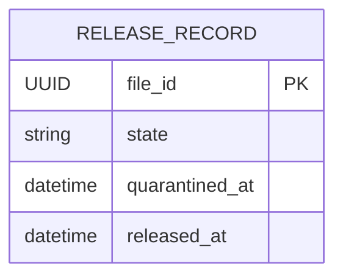

# Release Service

Owns the terminal release decision for a file that has finished quarantine. It
records `RELEASED` for a file only when the quarantine state is `CLEAN` and a
quarantine timestamp is present (business rule BR4). Release has its own H2
database and does not read another service's data.

| Item | Value |
|---|---|
| Port | 8084 (`SERVER_PORT`) |
| Base path | `/api/v1/releases` |
| Database | H2 file `data/release.mv.db` |
| Owner | Release |

## Start it

```bash
mvn -pl release-service -am package
java -jar release-service/target/release-service-1.0.0-SNAPSHOT.jar
```

Run from the repository root so the relative database path stays stable. Export
`SERVER_PORT`, `DB_URL`, `DB_USERNAME`, `DB_PASSWORD`, `DB_DRIVER` and `DDL_AUTO`
in this service's terminal to override configuration; see `.env.example`. Spring
Boot does not load that file automatically.

## API

| Method | Endpoint | Result |
|---|---|---|
| GET | `/health` | 200 liveness |
| POST | `/api/v1/releases` | 201 released, or the original record replayed |
| GET | `/api/v1/releases/{fileId}` | 200 release record; 404 when not released |

```bash
curl -i http://localhost:8084/api/v1/releases \
  -H 'Content-Type: application/json' \
  -H 'X-Correlation-Id: release-demo-1' \
  -d '{"fileId":"3f2a4e6c-1b2d-4c5e-8f90-123456789abc","quarantineState":"CLEAN","quarantinedAt":"2026-10-24T08:00:00Z"}'
```

```json
{"fileId":"3f2a4e6c-1b2d-4c5e-8f90-123456789abc","state":"RELEASED","quarantinedAt":"2026-10-24T08:00:00Z","releasedAt":"2026-10-24T08:00:02.431Z"}
```

`fileId` and a nonblank `quarantineState` of at most 32 characters are required.
`quarantinedAt` is deliberately optional in the contract: omitting it is a
business conflict (409), not a malformed request (400). Invalid UUIDs,
timestamps, malformed JSON and blank or oversized states return 400. A
non-JSON body returns 415. Errors use the shared format:

```json
{"timestamp":"...","status":409,"error":"Conflict","message":"Only CLEAN quarantined files can be released","path":"/api/v1/releases","correlationId":"release-demo-1","fieldErrors":{}}
```

`X-Correlation-Id` is echoed and included in service logs. See
[the OpenAPI contract](../docs/openapi/release.yaml).

## Business rules

1. `quarantineState` must equal `CLEAN` exactly. `clean`, ` CLEAN`, `INFECTED`,
   `FAILED`, `QUARANTINED` and `SCANNING` are rejected with 409.
2. `quarantinedAt` must be present, otherwise 409. A file cannot be released
   before it has been quarantined.
3. Rejected requests never insert a row.
4. Release is idempotent on `fileId`. The first successful request fixes the
   record; a repeat returns the same `releasedAt` and creates nothing new. The
   replay check runs before the state check, so a retry that carries stale
   evidence still receives the original decision instead of a new error.
5. `fileId` is the primary key. When simultaneous requests both observe an
   unreleased file, one insert wins and the loser reads and returns that
   committed row. Only a primary-key race is treated this way; any other
   integrity failure is still an error.

Intake remains `RECEIVED`; Release does not mutate Intake. Release also does not
call Quarantine yet, so the quarantine evidence in the request is trusted rather
than re-verified. That is a known limitation, listed below.

## Data design



One row per released file. `state` is `RELEASED`; `quarantined_at` keeps the
accepted quarantine evidence for audit and `released_at` is the decision time.
There are no cross-service foreign keys.

## Persistence

`spring.datasource.url` defaults to `jdbc:h2:file:./data/release` with
`ddl-auto: update`, so release records survive a restart. The URL is relative to
the working directory: starting the JAR from another directory opens a different
database. Use an absolute path to avoid that:

```bash
export DB_URL="jdbc:h2:file:/absolute/path/to/release-data/release"
```

`data/` and the H2 database, trace and lock files are ignored by Git. H2 in this
mode is embedded: one JVM owns the file, so this configuration does not support
several replicas of Release sharing state. A shared database server would be
required for that. Keep the URL and credentials unchanged across restarts.

## Tests

```bash
mvn -pl release-service -am test
```

`ReleaseServiceTest` covers the business rules, replay and the primary-key race
with mocked persistence. `ReleaseHttpTest` runs the real application on a random
port against an isolated in-memory database and covers replay, 8 simultaneous
requests, validation, 400/404/405/409/415 errors, the shared error model,
correlation IDs and health. Surefire reports are written to
`release-service/target/surefire-reports/`.

`scripts/release-persistence.py` proves the file-backed configuration survives a
real restart with an isolated temporary database:

```bash
mvn -pl release-service -am package
python3 scripts/release-persistence.py
```

## Limitations

* Release trusts the `quarantineState` supplied by the caller. A later change
  should read the state from Quarantine so a client cannot assert `CLEAN`.
* There is no endpoint to revoke or reverse a release; `RELEASED` is terminal.
* Authentication, authorization and audit logging beyond the correlation ID are
  outside this implementation.
