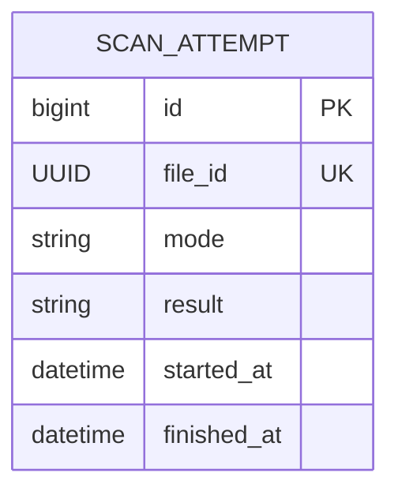

# Scanner Service

Mock malware scanner. It returns a deterministic result for a file and never
inspects real content. Only Quarantine calls it, over REST. `fileId` is the
operation identity: a file is scanned at most once, and every later request for
it, including a retry after a client timeout, replays the stored result. Scanner
has its own H2 database and does not read another service's data.

| Item | Value |
|---|---|
| Port | 8083 (`SERVER_PORT`) |
| Base path | `/api/v1/scans` |
| Database | H2 file `data/scanner.mv.db` |
| Owner | Scanner |
| Caller | Quarantine (`POST /api/v1/quarantine/{id}/scan`) |

## Start it

```bash
mvn -pl scanner-service -am package
java -jar scanner-service/target/scanner-service-1.0.0-SNAPSHOT.jar
```

Run from the repository root so the relative database path stays stable. Export
the variables in `.env.example` in this service's terminal to override
configuration. Spring Boot does not load that file automatically.

| Variable | Default | Purpose |
|---|---|---|
| `SERVER_PORT`, `DB_URL`, `DB_USERNAME`, `DB_PASSWORD`, `DB_DRIVER`, `DDL_AUTO` | see `.env.example` | Port and the Scanner-owned database |
| `SCANNER_SLOW_MILLIS` | 2000 | How long a `SLOW` scan takes |
| `SCANNER_IN_FLIGHT_WAIT_MILLIS` | 4000 | How long a repeat request waits for a running scan before 409 |
| `SCANNER_IN_FLIGHT_POLL_MILLIS` | 50 | How often that wait rereads the attempt |

## API

| Method | Endpoint | Result |
|---|---|---|
| GET | `/health` | 200 liveness |
| POST | `/api/v1/scans` | 200 deterministic result, or the stored result replayed |
| GET | `/api/v1/scans/{fileId}` | 200 stored attempt; 404 when the file was never scanned |
| GET | `/api/v1/scans/_evidence/summary` | 200 attempt counts by result |

```bash
curl -i http://localhost:8083/api/v1/scans \
  -H 'Content-Type: application/json' \
  -H 'X-Correlation-Id: scanner-demo-1' \
  -d '{"fileId":"7c1d2e3f-4a5b-4c6d-8e9f-0a1b2c3d4e5f","mode":"CLEAN"}'
```

```json
{"fileId":"7c1d2e3f-4a5b-4c6d-8e9f-0a1b2c3d4e5f","result":"CLEAN","message":"Deterministic mock result","completedAt":"2026-10-25T08:00:02.431Z"}
```

The response fields match the `ScannerResult` record that Quarantine reads.
`fileId` and `mode` are required. An invalid UUID, malformed JSON or a mode
outside `CLEAN`, `INFECTED`, `FAIL` and `SLOW` returns 400; a non-JSON body
returns 415. Errors use the shared format:

```json
{"timestamp":"...","status":409,"error":"Conflict","message":"File was already submitted for scanning with a different mode","path":"/api/v1/scans","correlationId":"scanner-demo-1","fieldErrors":{}}
```

`X-Correlation-Id` is echoed and included in service logs. Quarantine forwards
its own ID, so one ID follows a scan across both services. See
[the OpenAPI contract](../docs/openapi/scanner.yaml).

## Scan modes

| Mode | Result | Use |
|---|---|---|
| `CLEAN` | `CLEAN` | Main flow; the file can be released |
| `INFECTED` | `INFECTED` | Rejected release |
| `FAIL` | `FAILED` | A deterministic scan failure reported as a business result (HTTP 200) |
| `SLOW` | `CLEAN` after `SCANNER_SLOW_MILLIS` | Challenge 1 overlapping scans; Challenge 3A timeout and retry |

A stopped Scanner is the downstream outage for Challenge 3A. That case is
handled by Quarantine's timeouts, retries and FAILED transition, not here.

## Business rules

1. Results are deterministic: the same mode always gives the same result.
2. One attempt per file. `file_id` is unique. The first request commits an
   in-progress row before scanning, so any other request can see it.
3. A repeat for a finished scan returns the identical response, including
   `completedAt`, and writes nothing.
4. A repeat while the scan is still running waits up to
   `SCANNER_IN_FLIGHT_WAIT_MILLIS` for it and then replays its result. If it is
   still running after that, the answer is 409 and no second scan is started;
   retrying later is safe. Quarantine treats that 409 like any other failed
   attempt and retries with backoff.
5. Simultaneous first requests for one file race on the unique key. One insert
   wins and runs the scan; the losers follow that attempt. Only a race on that
   row is treated this way; any other integrity failure is still an error.
6. A repeat with a different mode for the same `fileId` returns 409 and leaves
   the stored result unchanged, the same rule Intake applies to an
   Idempotency-Key used with a different payload.
7. A result, once stored, is never changed.

### Why a timed-out retry does not scan twice

Quarantine's default read timeout is 5000 ms. With `SCANNER_SLOW_MILLIS` above
that, Quarantine gives up on attempt 1 while Scanner is still working. Scanner
keeps running and stores the result. Attempt 2 arrives after the backoff, finds
the in-progress row, waits and receives the same result. The Scanner database
then holds one attempt for the file, which `GET /api/v1/scans/{fileId}` and the
evidence summary show. `ScannerHttpTest.retryAfterClientReadTimeoutReplaysTheSingleInFlightScan`
reproduces this with a 300 ms client timeout.

The rule lives in the database row, not in a per-file lock held in memory, so it
does not depend on one JVM and there is no lock map that grows without bound.

## Assignment traceability

| Requirement | Code | Verification |
|---|---|---|
| Deterministic mock result per mode | `ScannerService.execute` | `ScannerServiceTest.firstScanStoresOneDeterministicResult`; `ScannerHttpTest.deterministicModesReturn200WithTheirResult` |
| Completed scan replays without another row (Challenge 2, Scanner side) | `ScannerService.existing` | `repeatedFileIdReplaysCompletedAttemptWithoutSavingAnotherRow`; `scanReplayAndReadAgreeWithOneStoredAttempt` |
| Retry after a read timeout replays the in-flight scan (Challenge 3A) | `ScannerService.awaitCompletion` | `retryDuringAnInProgressScanWaitsAndReplaysItsResult`, `scanStillInProgressAfterTheWaitIsConflictWithoutStartingAnotherScan`; `retryAfterClientReadTimeoutReplaysTheSingleInFlightScan` |
| Simultaneous scans of one file run once | `ScanAttemptWriter.claim`, unique `file_id` | `simultaneousFirstScanRaceFollowsTheCommittedWinner`, `unrelatedDatabaseFailureIsNotTreatedAsReplay`; `eightSimultaneousSlowScansOfOneFileRunOnce` |
| Same file with a different mode is rejected | `ScannerService.existing` | `sameFileWithDifferentModeIsConflict`; `sameFileWithDifferentModeReturns409WithoutChangingTheResult` |
| Stored result is never overwritten | `ScanAttempt.finish` | `finishedAttemptCannotBeOverwritten`; `interruptedSlowScanIsStoredAsFailedAndKeepsTheInterrupt` |
| Consistent error model and correlation ID | shared `common` handler and filter | `invalidInputReturnsConsistent400WithoutStoringAnything`, `unknownAttemptReturns404AndInvalidUuidReturns400`, `wrongMethodAndContentTypeKeepTheirHttpStatuses`, `healthStillWorks` |
| Stored results survive a restart | `application.yml`, file-backed H2 with `update` | `scripts/scanner-persistence.py`; `evidence/tests/scanner-persistence.txt` |

## Data design



One row per scanned file. `result` and `finished_at` are null while the scan
runs and are set once. `file_id` refers to the Intake file logically; there are
no cross-service foreign keys.

## Persistence

`spring.datasource.url` defaults to `jdbc:h2:file:./data/scanner` with
`ddl-auto: update`, so stored results survive a restart and a Quarantine retry
after a Scanner restart still replays. The URL is relative to the working
directory; use an absolute path to avoid opening a different database:

```bash
export DB_URL="jdbc:h2:file:/absolute/path/to/scanner-data/scanner"
```

For a throwaway run, use `DB_URL='jdbc:h2:mem:scanner;DB_CLOSE_DELAY=-1'` and
`DDL_AUTO=create-drop`. `data/` and the H2 files are ignored by Git. Embedded H2
has one owner process, so several Scanner replicas cannot share it; that needs a
database server.

## Tests

```bash
mvn -pl scanner-service -am test
```

`ScannerServiceTest` covers each mode, replay, the in-flight wait, the
unique-key race, the mode conflict and interruption with mocked persistence.
`ScannerHttpTest` runs the real application on a random port against an
isolated in-memory database. It covers replay, a client read timeout followed by
a retry, 8 simultaneous scans of one file, validation, 400/404/405/409/415
errors, the shared error model, correlation IDs and health. Surefire reports are
written to `scanner-service/target/surefire-reports/`.

`scripts/scanner-persistence.py` proves a stored result survives a real restart
with an isolated temporary database:

```bash
mvn -pl scanner-service -am package
python3 scripts/scanner-persistence.py
```

## Limitations

* If the process stops mid-scan, its row stays in progress. Later requests for
  that file get 409 until the row is removed; there is no stale-attempt takeover.
* A caller that gives up does not cancel the scan; the request thread runs to
  completion. With `SLOW` mode this holds a thread for `SCANNER_SLOW_MILLIS`.
* A waiting retry holds a request thread while it polls the database.
* Scanner trusts the `mode` that Quarantine sends; it does not check the file
  with Intake.
* Results are mocked; no real file is stored or scanned.
